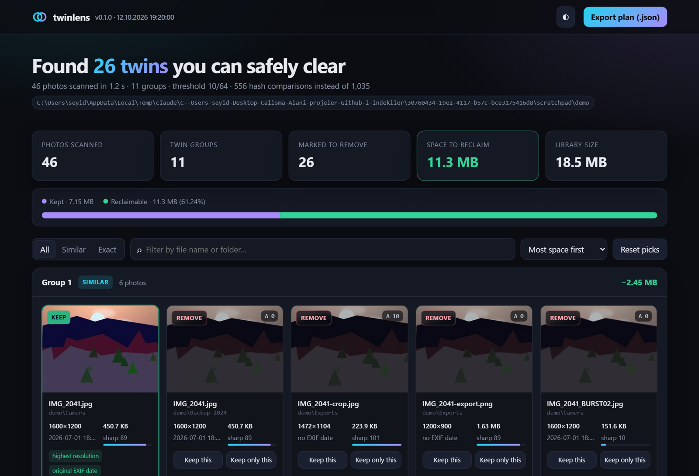
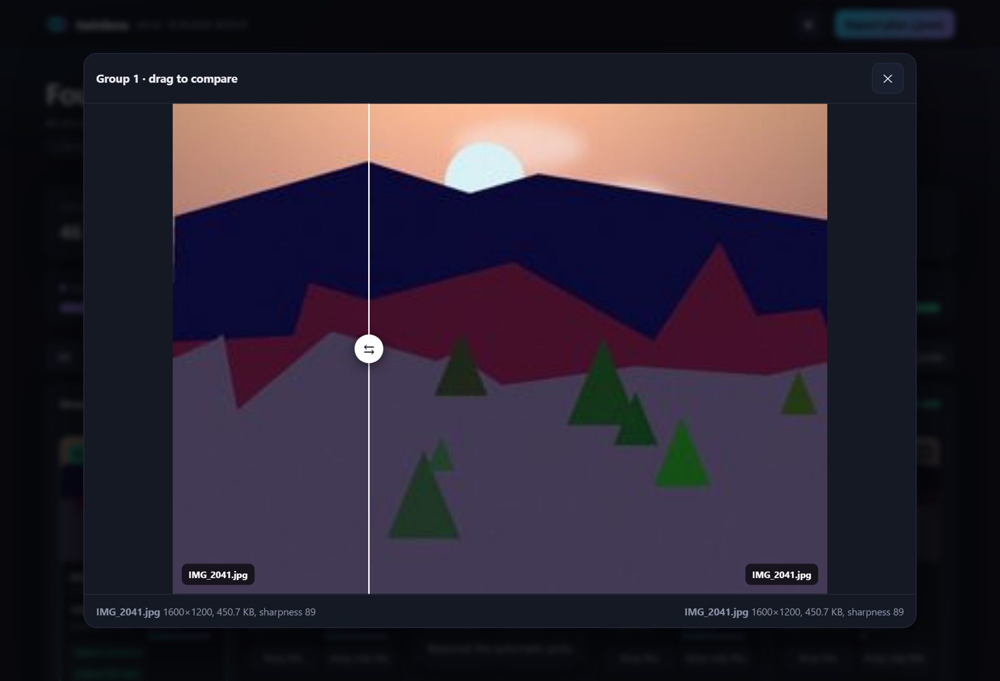
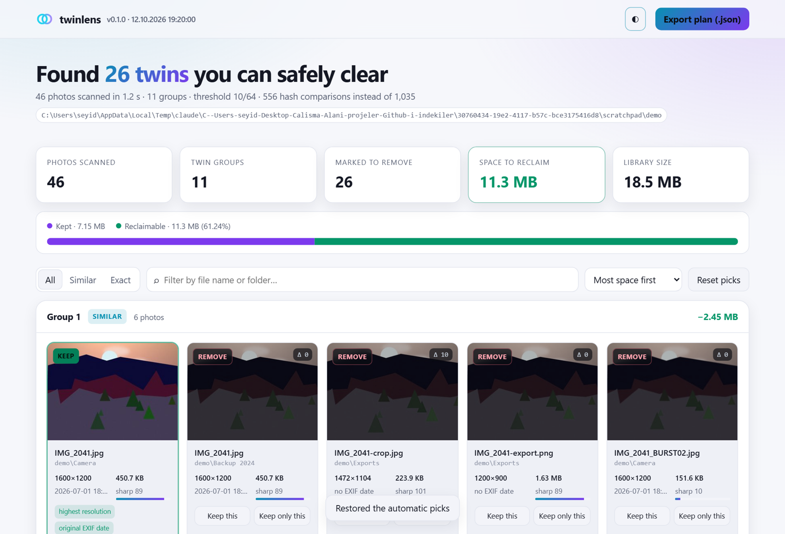
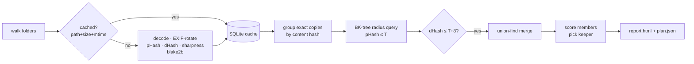

<div align="center">

# ◯◯ twinlens

**Your camera roll has the same sunset five times.** twinlens finds near-duplicate photos — messenger
recompressions, resized exports, crops, edits, blurry burst frames, forgotten backups — picks the best
shot in every group, and clears the rest **without ever deleting anything**.

[](https://github.com/ardazeybek-dev/twinlens/actions/workflows/ci.yml)
[](https://ardazeybek-dev.github.io/twinlens/)
[](pyproject.toml)
[](LICENSE)

[**Open the live report →**](https://ardazeybek-dev.github.io/twinlens/)



</div>

---

## Why

Phones and chat apps silently multiply photos. The same picture ends up as the camera original, a
WhatsApp copy at a quarter of the resolution, a PNG export, a cropped version for Instagram and a copy
inside last year's backup folder. Byte-level duplicate finders only catch the last one, because every
other copy has *different bytes*.

twinlens compares what the photos **look like**, not what their files contain:

| Copy type                         | byte-hash tools | twinlens |
| --------------------------------- | :-------------: | :------: |
| identical backup                  |        ✅        |    ✅     |
| messenger recompression (JPEG q55) |        ❌        |    ✅     |
| resized / re-encoded export (PNG)  |        ❌        |    ✅     |
| brightness / exposure edit         |        ❌        |    ✅     |
| blurry burst frame                 |        ❌        |    ✅     |
| small crop (≈ 4 %)                 |        ❌        | sometimes |
| rotated by EXIF orientation        |        ❌        |    ✅     |

## Features

- **Perceptual hashing from first principles** — DCT-based pHash and gradient dHash, written with NumPy
  (no OpenCV, no black-box hashing library).
- **Sub-quadratic search** — a BK-tree over the Hamming metric, so 50 000 photos don't need
  1.25 billion comparisons. Every report shows how many comparisons were actually made.
- **Two-stage verification** — pHash proposes, dHash confirms. Different scenes that happen to share
  a colour palette are rejected.
- **Picks the keeper for you** — resolution, contrast-normalised sharpness (Laplacian variance),
  compression level and surviving EXIF metadata; ties go to the oldest file and the shortest path.
- **Interactive offline report** — one self-contained HTML file: before/after slider, keep/remove
  toggles, filters, light/dark theme and a live "space to reclaim" meter. Export your edited plan.
- **Nothing is deleted, ever** — `apply` is a dry run by default; with `--yes` files are *moved* to a
  quarantine folder, a manifest is written after every single move, and `undo` puts everything back.
- **Fast re-scans** — results are cached in SQLite keyed by path, size and mtime; hashing runs on every
  CPU core.
- **HEIC ready** — iPhone photos work with the optional `heif` extra.
- **Privacy-friendly reports** — paths under your home folder are shown as `~/…`, and nothing leaves your machine.

## Quick start

```bash
git clone https://github.com/ardazeybek-dev/twinlens.git
cd twinlens
python -m venv .venv
# Windows: .venv\Scripts\activate    macOS/Linux: source .venv/bin/activate
pip install -e .            # add [heif] for iPhone HEIC photos: pip install -e ".[heif]"
```

Try it on a generated library first (no real photos needed):

```bash
twinlens demo demo-photos
twinlens scan demo-photos --open
```

Then on your own photos:

```bash
twinlens scan ~/Pictures "D:/Phone backup" --open    # 1. look
twinlens apply twinlens-report/plan.json             # 2. dry run: what would move?
twinlens apply twinlens-report/plan.json --yes       # 3. move removals to quarantine
twinlens undo                                         #    changed your mind? restore everything
```

When you're happy, delete the `twinlens-quarantine` folder yourself — or keep it as an archive.

```text
◯◯ twinlens  v0.1.0
  46 photos in 1.1s (0 cached, 556 comparisons vs 1,035 brute force)
  11 twin groups · 26 removable copies · 11.3 MB to reclaim

  similar #1   keep IMG_2041.jpg  (highest resolution, original EXIF date)  −2.4 MB
            ↳ IMG_2041.jpg  Δ0  450.7 KB
            ↳ IMG_2041-crop.jpg  Δ10  223.9 KB
            ↳ IMG_2041-export.png  Δ0  1.6 MB
            ↳ IMG_2041_BURST02.jpg  Δ0  151.6 KB
            ↳ IMG-20260014-WA0000.jpg  Δ0  14.0 KB
```

## The report

| Drag to compare any copy with the keeper | Light theme |
| --- | --- |
|  |  |

Click a photo to compare it with the keeper, toggle **Keep / Remove**, or **Keep only this** to override
the automatic choice. Picks are remembered in your browser. **Export plan** downloads a `plan.json`
in exactly the format `twinlens apply` reads. A group where nothing is kept is flagged and skipped.

## How it works



**pHash.** The photo is reduced to a 32×32 grayscale image and transformed with an orthonormal 2-D
DCT-II (`C · X · Cᵀ`, the same transform JPEG uses). The top-left 8×8 block holds the coarse
structure of the picture; the DC term (average brightness) is dropped and every remaining coefficient
becomes one bit: above or below the median. Rescaling, recompression and exposure changes barely move
those low frequencies, so twins land a few bits apart.

**dHash.** A 9×8 thumbnail; each bit says whether a pixel is brighter than its right-hand neighbour.
It reacts to structure that pHash smooths over, which makes it a cheap second opinion.

**BK-tree.** Items are filed under their parent by Hamming distance. By the triangle inequality, a
query for everything within *r* of *q* only needs to descend into children whose edge label lies in
`[d(q,node) − r, d(q,node) + r]`. For small radii that prunes most of the tree.

**Union-find.** Every confirmed pair is merged into one group (path halving, union by size), so A≈B and
B≈C end up together even if A and C are a little further apart.

**Choosing the keeper.** Inside a group each photo scores
`0.45·resolution + 0.40·sharpness + 0.15·file size` (each relative to the best in the group), plus a
bonus for an intact EXIF capture date — messengers strip it, cameras don't. Sharpness is the variance
of the Laplacian on a 512 px, contrast-normalised version of the image, so a brightened edit is not
mistaken for a sharper one and a sharp small copy scores like a sharp large one.

### Choosing a threshold

`--threshold` is the maximum pHash distance (out of 64 bits) for two photos to count as twins.

| Threshold | Behaviour |
| --- | --- |
| `0` | only visually identical images |
| `6` | strict — recompressions and resizes |
| `10` *(default)* | balanced — adds edits, blurry bursts and light crops |
| `14` | aggressive — review the report carefully |

## Safety model

1. `scan` only reads files.
2. `apply` without `--yes` only prints what it would do.
3. Before moving a file, `apply` re-checks its size and content hash against the scan and skips
   anything that changed. A group whose keepers are all missing is skipped entirely.
4. Files are moved into `twinlens-quarantine/<timestamp>/` mirroring their original absolute path;
   name clashes get a numeric suffix, nothing is overwritten.
5. `manifest.json` is rewritten after every move, so even an interrupted run is fully undoable.
6. `undo` refuses to overwrite a file that has reappeared at the original location.

## Command reference

| Command | Purpose | Useful flags |
| --- | --- | --- |
| `twinlens scan PATH…` | hash, group, write `report/index.html` + `plan.json` | `-t/--threshold`, `-w/--workers`, `-o/--out`, `--json FILE`, `--open`, `--no-cache`, `--no-report`, `--top N` |
| `twinlens apply PLAN` | move the plan's removals to quarantine (dry run by default) | `--yes`, `-q/--quarantine`, `--no-verify` |
| `twinlens undo [MANIFEST]` | restore from quarantine (latest manifest by default) | `--dry-run`, `-q/--quarantine` |
| `twinlens demo [DIR]` | generate a synthetic library full of duplicate traps | `--scenes N`, `--clean` |

`python -m twinlens …` works too.

## Configuration

Settings come from, in increasing priority: built-in defaults → a `.env` file in the current
directory → environment variables → command-line flags. Copy [`.env.example`](.env.example) to `.env`
to get started.

| Variable | Default | Meaning |
| --- | --- | --- |
| `TWINLENS_THRESHOLD` | `10` | max pHash Hamming distance (0–64) |
| `TWINLENS_WORKERS` | `0` | hashing processes, `0` = one per core |
| `TWINLENS_CACHE` | `.twinlens/cache.sqlite` | hash cache location |
| `TWINLENS_REPORT_DIR` | `twinlens-report` | where `scan` writes the report and plan |
| `TWINLENS_QUARANTINE` | `twinlens-quarantine` | where `apply` moves files |
| `TWINLENS_THUMB_SIZE` | `320` | longest edge of report thumbnails (px) |

## Project layout

```text
twinlens/
├── src/twinlens/
│   ├── hashing.py        # DCT-II matrix, pHash, dHash, Hamming distance
│   ├── bktree.py         # BK-tree for metric radius queries
│   ├── imaging.py        # decoding, EXIF orientation/date, sharpness, PhotoRecord
│   ├── scanner.py        # folder walk, parallel hashing, error collection
│   ├── cache.py          # SQLite hash cache
│   ├── cluster.py        # union-find, twin verification, keeper scoring
│   ├── plan.py           # plan / quarantine / manifest / undo
│   ├── report.py         # self-contained HTML report with embedded thumbnails
│   ├── templates/report.html
│   ├── demo.py           # procedural "camera roll" generator
│   ├── config.py         # .env + environment + flag merging
│   └── cli.py            # scan · apply · undo · demo
├── tests/                # hashing, BK-tree, end-to-end pipeline, safety, CLI
├── docs/                 # screenshots
├── .github/workflows/    # CI matrix (Linux/Windows/macOS) + live demo on Pages
├── .env.example
└── pyproject.toml
```

## Development

```bash
pip install -e ".[dev]"
pytest              # 32 tests, includes a full scan → apply → undo round trip
ruff check src tests
```

All test images are generated procedurally by `twinlens.demo` — the repository contains no real
photos. The live demo is rebuilt from the same generator on every push to `main`.

## Known limits & pitfalls

- Crops of ~4 % or more and rotations other than EXIF orientation often move the low DCT frequencies too far → raise `--threshold` to ~14 for crop-heavy libraries and review the report.
- Very flat images (sky, documents, solid colours) have few strong frequencies, so unrelated shots can land close in pHash → the dHash check catches most; keep the default threshold for screenshots and scans.
- `.heic` files are skipped with an error unless `pillow-heif` is installed → `pip install -e ".[heif]"`.
- Bursts are grouped by similarity, so a burst of genuinely different moments can still collapse into one group → use **Keep** on every frame you want before exporting the plan.
- Calling `twinlens.scanner.scan(..., workers>1)` or `twinlens.cli.main()` from your own script spawns worker processes on Windows/macOS → put the call under `if __name__ == "__main__":`, or use `workers=1`.

## License

[MIT](LICENSE) © Arda Zeybek
